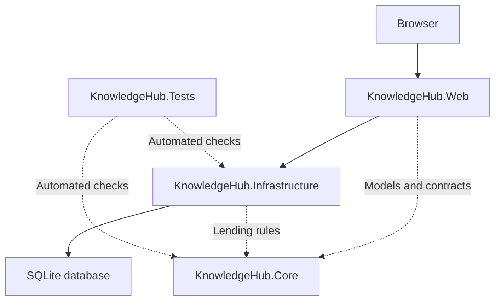

# Rasuli's Knowledge Hub

**Student: Alireza Rasuli**

An individual C# / .NET 10 / Blazor project for a small library. Admin manages books, physical copies, members and circulation. Members find books, reserve them and manage their own loans. A reservation queue allocates available copies fairly and updates connected screens after changes.

## Submission structure

The source package contains 50 files. Keep these folders and configuration files together when extracting or submitting it.

| Item | Why it is included |
|---|---|
| `KnowledgeHub.sln` | Opens and builds the application and tests |
| `src/KnowledgeHub.Core` | Models, interfaces and lending rules |
| `src/KnowledgeHub.Infrastructure` | SQLite storage, accounts and circulation services |
| `src/KnowledgeHub.Web` | Website pages, shared components, CSS and startup settings |
| `tests` | Automated checks and the recorded test results |
| `vendor` | Framework asset package for the documented offline restore |
| `Directory.Build.props` | Shared compiler settings |
| `NuGet.Config` | Package sources and local cache configuration |
| `README.md` | Setup, use, database explanation and defense guidance |



Build output, package caches, temporary logs and runtime databases are excluded. The application creates its database on first launch. Preserve `App_Data` after you start using the application because it contains your saved records and authentication keys.

## Start the project

Install the **.NET 10 SDK** (the SDK, not only the runtime) and use a modern browser. This version was built with SDK **10.0.401** and ASP.NET Core **10.0.12** on Windows. Windows supplies SQLite; Linux needs the native SQLite library, for example `libsqlite3-0` on Ubuntu. The adapter also includes the macOS SQLite library path. Linux/macOS execution remains unverified.

Extract the ZIP, open a terminal inside `RasuliKnowledgeHub`, and run:

```text
dotnet restore KnowledgeHub.sln
dotnet build KnowledgeHub.sln --no-restore
dotnet run --project src/KnowledgeHub.Web --no-build
```

Open **http://localhost:5080**. Keep the terminal running; Ctrl+C stops the server. An editor such as Visual Studio or VS Code is optional. No Node.js, SQL Server, database account or paid service is required.

For the tested SDK, the bundled framework asset package also supports an offline restore:

```text
dotnet restore KnowledgeHub.sln --source vendor -p:NuGetAudit=false
```

Another SDK patch may need its matching assets from NuGet. The ordinary restore command allows that. `bin`, `obj` and `.packages` are generated automatically and are excluded from the supplied ZIP.

### Demonstration accounts

| Username | Initial password | Access |
|---|---|---|
| `admin` | `Admin2026!` | Manage members, books, copies, lending and reports |
| `rasuli` | `Rasuli2026!` | Browse, reserve and renew own loans |

Login also accepts the corresponding email: `admin@knowledgehub.local` or `rasuli@knowledgehub.local`. A fresh development database gets exactly these two accounts, 12 titles, 23 copies, two Rasuli loans and one ready reservation. Demo seeding happens once and never resets an existing password. Change passwords through **Account settings**. Use these published credentials only for a local demonstration.

## How to use it

1. **Add a member:** sign in as admin, open **Members**, choose **Add member**, enter full name, a unique username, email and initial password, then create the member. Usernames use 3–30 letters, numbers, dots, underscores or hyphens, beginning with a letter or number. Passwords require 10–128 characters, uppercase, lowercase and a number. Public registration also creates members; it cannot create admins.
2. **Add a book:** use **Add book** from the catalog. Enter title, author, unique 13-digit ISBN, category, year, shelf, description, cover style and copy count. Save it. One title can have several separately tracked physical copies. The ISBN check validates the 13-digit format, not the ISBN checksum.
3. **Edit or add copies:** open the book's details and select **Edit book** or **Add copy**. Each copy receives a `KH-` barcode. Retire an available copy when it leaves the collection. Archive a title to hide it while preserving history; active lending or reservations can prevent removal.
4. **Search:** use the catalog search, category, availability, sorting and page controls. The catalog is public; a login is required for borrowing-related actions.
5. **Reserve:** sign in as rasuli, open a book and select **Reserve this book**. An available copy becomes a 48-hour pickup hold. Otherwise the member joins the waiting queue. **Reservations** shows the status and allows cancellation.
6. **Issue:** admin opens the book, selects a member and clicks **Issue book**. The service honors an existing pickup hold and otherwise chooses an available copy. Members cannot issue books to themselves.
7. **Renew:** a member uses **My loans**. One renewal adds 14 days to the existing due date. Overdue loans, already renewed loans and titles with waiting readers cannot be renewed.
8. **Return:** admin opens **Circulation** and selects **Return**. The loan remains in history. A waiting reservation receives the copy before it becomes generally available.
9. **Reports:** admin views totals, popular titles and recent activity, and downloads the loan CSV. Member accounts cannot access admin reports or other members' records.

Rules: a loan lasts **14 days**, with at most **5 active loans** and **3 active reservations** per member. Overdue borrowing blocks new loans. The background worker checks hold expiry every **30 seconds**.

## Code and database explanation

The architecture separates three responsibilities. `KnowledgeHub.Core` holds models, interfaces and lending rules. `KnowledgeHub.Infrastructure` implements account and library services plus SQLite persistence. `KnowledgeHub.Web` owns the Blazor UI and HTTP configuration. Infrastructure and Web reference Core. The tests reference the application projects.

The UI uses **HTML markup inside `.razor` files**, CSS and C# handlers. This is Blazor, as required by the rubric. Interactive Server mode runs handlers on the server and updates the browser through Blazor's SignalR connection. Authentication forms use ordinary POST requests so the server can set or clear the login cookie.

| File or folder | Purpose |
|---|---|
| `src/KnowledgeHub.Core/Models.cs` | Visible app name, models, lending rules and service contracts |
| `src/KnowledgeHub.Infrastructure/AccountService.cs` | Username validation, password hashing, login, lockout and password changes |
| `src/KnowledgeHub.Infrastructure/LibraryService.cs` | Search, copies, loans, reservations, reporting and access checks |
| `src/KnowledgeHub.Infrastructure/LibraryDatabase.cs` | SQL tables, indexes, migration and atomic transactions |
| `src/KnowledgeHub.Infrastructure/Sqlite.cs` | Small parameterized adapter over the native SQLite API; closes connections and statements |
| `src/KnowledgeHub.Infrastructure/DemoSeed.cs` | Initial local accounts and example books |
| `src/KnowledgeHub.Web/Program.cs` | Service registration, authentication, startup, HTTP routes and middleware |
| `src/KnowledgeHub.Web/Services/AppServices.cs` | Catalog state, shared page behavior, hold timer and session revalidation |
| `src/KnowledgeHub.Web/Components/Pages` | Individual screens and their event handlers |
| `src/KnowledgeHub.Web/Components/Shared` | Reusable table, book tile, notice, pagination, badge and statistic components |
| `src/KnowledgeHub.Web/Components/Layout` | Shared navigation and login layouts |
| `src/KnowledgeHub.Web/wwwroot/app.css` | Colors, spacing and responsive layouts |
| `tests/KnowledgeHub.Tests` | Automated rules, database, HTTP and optional browser checks |
| `tests/test-results.json` | Latest verification: 61 passing checks and 12 HTTP checks blocked by the execution environment |

The default database is **`src/KnowledgeHub.Web/App_Data/knowledgehub.db`** when started as above. It is created automatically and persists after closing the app. Cookie protection keys live in `App_Data/keys`. Set `KnowledgeHub__DataDirectory` to choose another directory. Browser cookies contain identity claims, not the library records or password.

| Table | Stored information and relationships |
|---|---|
| Users | Unique usernames/emails, hashed passwords, roles, session stamps and lockout state |
| Books | Title information; one book has many Copies |
| Copies | Physical barcodes; each copy belongs to one book |
| Loans | Member + physical copy + borrowed/due/returned dates |
| Holds | Member + title + queue status; a ready hold also identifies a copy |
| Audit | Who performed an operation, what changed and when |

Dates use UTC. Passwords use ASP.NET Core's `PasswordHasher`; plaintext passwords are not stored. The internal admin role is named **`Librarian`**, while the interface labels it **Admin**. The database stores role and ownership checks independently of what the UI displays.

Example: issuing a book starts a transaction, checks the member and availability, inserts the loan and fulfills any relevant hold. It commits all changes together or rolls them back on failure. Unique indexes prevent two active loans on one copy. Stale book edits fail using a version number. After a successful write, a shared change event refreshes connected pages. Catalog filters live in a scoped state container for that browser circuit; they are not permanent database settings.

SQLite uses write-ahead logging and short transactions. It still permits one writer at a time. Keep the database on a local disk. For multiple application servers, replace the in-process event bus and use a suitable shared database; this version does not claim distributed scalability. See the [SQLite WAL documentation](https://www.sqlite.org/wal.html).

To back up: stop the app, copy the **whole `App_Data` directory**, then restart. Restore with the app stopped. Do not delete database or key files to tidy the project. The supplied ZIP contains no personal database. For a fresh demo, select a new data directory instead of deleting existing records. Schema version 2 adds usernames to an older database without erasing users, using their existing emails as initial usernames.

HTTP routes are deliberately small: `/auth/login`, `/auth/register`, `/auth/logout` and `/auth/password` accept protected form POSTs; `/health` reports availability; `/reports/loans.csv` requires admin authorization. Core library operations use C# service interfaces rather than a separate REST API.

## Change the name or appearance

Change `AppInfo.Name` in `Models.cs` for the visible app name. Change the collection label in `BookCover.razor` and the initial/logo in the layouts and `favicon.svg` if rebranding completely. Technical solution names do not need to change.

Edit HTML labels and layout in the relevant `.razor` page; edit colors and spacing in `app.css`. Wording or CSS changes normally need no service/database edits. Preserve bindings such as `@bind`, `@onclick`, `@if`, component parameters and form field names. Changing a data field, rule or event handler can require corresponding model, service, validation and test changes. Run `dotnet watch --project src/KnowledgeHub.Web` while developing; rebuild before the defense.

## Verification and rubric evidence

The clean submission build on **15 November 2026** passed with **0 warnings and 0 errors**. All **61 rule/database/account/concurrency/performance checks passed**. The **12 HTTP checks could not execute** because the managed environment denied local socket access to the test server. The runner records those blocked requests as failures in `tests/test-results.json`; this run does not establish an application-level HTTP regression. The paged query over 2,000 titles took 2.7 ms, a single local measurement rather than a load benchmark or coverage percentage.

The earlier development run recorded **73/73 passing checks**. Repeat the complete command below on the defense computer to obtain current HTTP evidence before submission.

With a fresh demo app running at port 5080, run:

```text
dotnet run --project tests/KnowledgeHub.Tests --no-build -- --http http://localhost:5080 --out tests/test-results.json
```

This is a self-contained console test runner, so use this command rather than `dotnet test`. Without `--http`, it runs the 61 checks that do not require the web server. The optional browser suite requires an installed Chrome/Edge executable:

```text
dotnet run --project tests/KnowledgeHub.Tests --no-build -- --http http://localhost:5080 --browser "C:\Program Files\Google\Chrome\Application\chrome.exe" --out tests/test-results.json
```

The browser suite compiles, but this managed environment could not start its headless browser; **that suite has not passed here**. Separate interactive browser checks successfully exercised admin/member login, search, adding a member, adding/editing a book, reservation, live updates, issue, renewal, return and history. Cross-browser/device/OS testing and measured code coverage remain pending.

| Rubric criterion (each 5%) | Implementation or evidence |
|---|---|
| 1. Structure/design | Three application layers, service interfaces and shared rules |
| 2. Reusability | Generic table and shared components with parameters, templates and callbacks |
| 3. Cross-platform | .NET/browser architecture and native SQLite resolution; Windows verified, other OS checks pending |
| 4. State | Scoped catalog container, cascading authentication and change notifications |
| 5. UI | Consistent green/cream styling, book covers and role-specific navigation |
| 6. UX | Form feedback, confirmations, empty states and labeled controls |
| 7. Responsive | Flexible grid and tablet/phone CSS breakpoints; physical-device QA pending |
| 8. Core features | Books, copies, members, loans, returns, reservations and reports |
| 9. Advanced features | Role/ownership protection, live refresh, timed holds and session invalidation |
| 10. Resilience | Validation, rollback, concurrency constraints, safe error messages and worker retry |
| 11. Efficiency | Server rendering, paged catalog and indexed queries |
| 12. Scalability | Modular boundaries and bounded catalog pages; single-server limitations documented |
| 13. Resources | Operation-scoped database connections and event unsubscription |
| 14. Testing | 61 checks pass in the clean copy; current HTTP verification is blocked by local socket restrictions. Earlier development run: 73/73. Browser suite execution and coverage remain pending |
| 15. QA | Main desktop workflows checked; broader device/browser matrix pending |
| 16. Documentation | This guide, source comments and recorded test results |
| 17. Innovation | Fair copy allocation with expiring pickup holds and live availability |
| 18. C#/.NET/Blazor | Generic Razor components, DI, hosted worker, TimeProvider and native interop |
| 19. Professionalism | Validated source, role separation, preserved history and clean source package |
| 20. Presentation | Linked defense deck and the demonstration plan below |

This evidence supports the rubric; it does not guarantee full marks or replace the mandatory defense. Before public deployment, configure HTTPS, production admin credentials (`KnowledgeHub__AdminEmail` / `KnowledgeHub__AdminPassword`), allowed hosts, protected key storage and tested backups. Production startup does not create the public demo accounts. Only the initial production admin is seeded; create members through the application. 

## Included dependency

`vendor/microsoft.aspnetcore.app.internal.assets.10.0.12.nupkg` is the unmodified Microsoft framework asset package used by the tested SDK, retained to support restoring this project in a restricted network. Its license metadata and third-party notices remain inside the package. Everything else in this archive is application source, build configuration, this guide or required testing evidence; generated binaries and demo databases are excluded.
